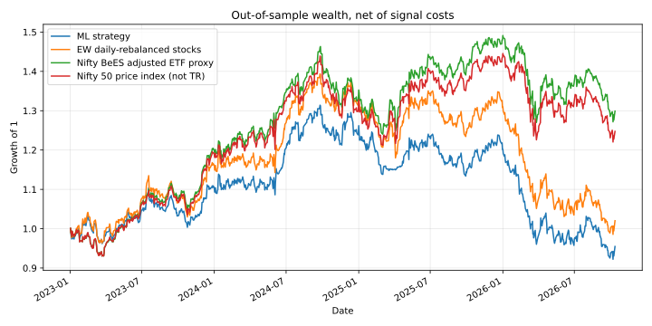
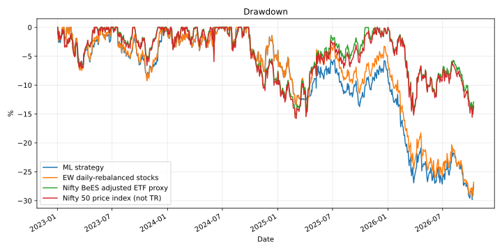
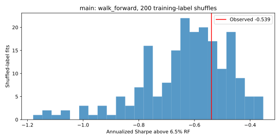
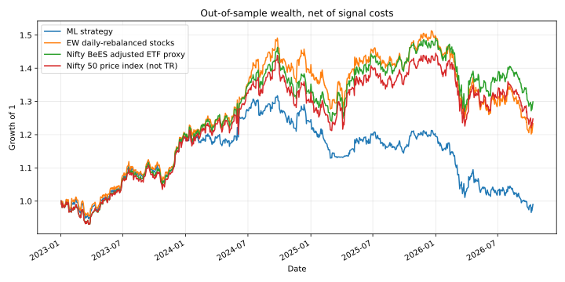
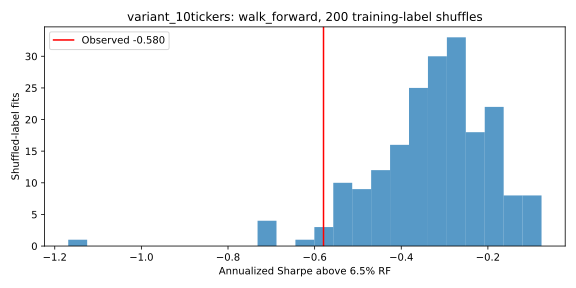

# Does ML beat the market? An expanding-window NSE backtest

A fixed gradient-boosting model predicts next-session direction from price/volume features. Yearly out-of-sample retraining does **not demonstrate a positive trading edge** in either tested universe. The estimates are noisy, and some paired comparisons support underperformance, not equivalence. This is a small educational experiment, not investment advice.

## Reproduce

```bash
python -m venv .venv
source .venv/bin/activate
pip install -r requirements.txt
python -m pytest -q
OMP_NUM_THREADS=1 python src/run.py
OMP_NUM_THREADS=1 python src/run.py --tag variant_10tickers --tickers RELIANCE.NS TCS.NS INFY.NS HDFCBANK.NS ICICIBANK.NS ITC.NS SBIN.NS LT.NS BHARTIARTL.NS HINDUNILVR.NS
```

Tested with Python 3.10.12 on Linux. Direct dependencies are pinned; `requirements-lock.txt` records the tested environment. The default cutoff is **2026-10-15 exclusive**, not an automatically moving "present". Both static and yearly walk-forward results are produced. Each gets 5,000 paired 20-trading-day circular block-bootstrap draws and 200 training-label shuffles, seeded deterministically. Reusing completed shuffle CSVs makes reruns faster; delete that result directory after changing data/model/settings to avoid mixing experiments. Use a new `--tag` for a changed configuration. `--refresh` replaces data and reruns the null fits.

## Model and timing

- Main universe: RELIANCE, TCS, INFY, HDFCBANK, ICICIBANK, ITC. The ten-stock variant adds SBIN, LT, BHARTIARTL and HINDUNILVR. These are selected current large caps, so survivorship/selection bias remains.
- Same 11 features and classifier as the original experiment: returns over 1/5/10/20 sessions, volatility over 10/20, volume change over 5, relative volume over 20, RSI(14), RSI(5), and distance from the 50-session moving average. HistGradientBoostingClassifier: max_depth=3, learning_rate=.05, max_iter=150, min_samples_leaf=100, l2_regularization=1, random_state=0. No new features or tuned hyperparameters.
- Initial training starts in 2016; first test signal is January 2, 2023. Expanding-window retraining occurs at each calendar-year boundary for 2023, 2024, 2025 and 2026. Each model predicts only its following year; results are stitched without resetting positions/costs at fold boundaries. The static comparison fits only once before 2023.
- A row dated t uses information through close t and targets the next shared-calendar close. Before each fit, require both signal date and **label end strictly before the fold boundary**. `statistics.json` records every fold's last training label and first test signal. Tests check this purge and feature causality.
- Long when p>0.5, otherwise flat. Each stock gets a fixed 1/N capital slot; no leverage. Missing-feature slots remain cash. Returns are the daily-rebalanced mean of these slots, never a mean over only whichever stocks survived feature filtering. Cash earns zero; 6.5% is a performance hurdle, not credited cash interest.
- Costs preserve the original simplified convention: 0.1% times absolute changes in binary position, with first entries charged. The equal-weight daily-rebalanced stock portfolio and ETF/index comparators each pay a 0.1% first-entry charge. **Drift-rebalancing turnover, terminal liquidation, spread, taxes/STT and slippage are omitted**. Thus "net" means net of these signal/entry costs only, not implementable after all trading costs. Same-close signal execution is an optimistic assumption.

## Benchmarks and data quality

All new annualized Sharpes use daily excess return over `(1.065**(1/252)-1)` (about 0.0250% daily), divided by sample daily volatility and multiplied by sqrt(252). **6.5% is a fixed assumed India T-bill proxy, not a historical rate series.** CAGR/wealth remain actual strategy returns; subtracting RF affects only Sharpe.

The stock comparator is an **equal-weight daily-rebalanced portfolio**, not buy-and-hold. NIFTYBEES.NS adjusted prices give an investable Nifty ETF proxy: fund expenses, tracking error and market prices differ from an official total-return index. A direct `^NSEITR` request returned no data. `^NSEI` remains a clearly labeled **price index, not total return**, for continuity, not a dividend-matched primary comparator. Adjusted Yahoo prices are not point-in-time corporate-action data.

We intersect usable closing-price dates across all stocks and both benchmarks **before** computing features/returns, ensuring matching holding periods. We do not replace missing benchmark returns with zero. The snapshot ends at the October 13, 2026 common close, yielding 930 out-of-sample holding periods, with last signal October 12. Excluded dates are recorded per run. Missing volume features affect 100 main-universe and 180 ten-stock out-of-sample capital slots. The old code silently reweighted these dates toward the remaining ticker (notably ITC in March-April 2025); the corrected code leaves those slots in cash. See [data notes](data/README.md) and snapshot checksums.

## Measured results

All new Sharpes below subtract the same RF hurdle. Table values are rounded for display; CSV/JSON retain precision.

| Universe          | Method       |   Strategy CAGR % |   Excess Sharpe |   Max drawdown % |   Directional accuracy % |
|:------------------|:-------------|------------------:|----------------:|-----------------:|-------------------------:|
| main              | static       |            -4.897 |          -0.933 |          -37.59  |                   48.887 |
| main              | walk_forward |            -1.248 |          -0.539 |          -29.814 |                   48.978 |
| variant_10tickers | static       |             3.437 |          -0.194 |          -24.687 |                   49.803 |
| variant_10tickers | walk_forward |            -0.264 |          -0.58  |          -26.701 |                   50.208 |

The stock portfolio CAGR/excess Sharpe is 0.544%/-0.364 (six stocks) and 5.846%/0.013 (ten stocks). The adjusted Nifty BeES proxy is 7.345%/0.126; the Nifty price index is 6.173%/0.039. These benchmark values are the same for static and walk-forward on the same calendar.

### Uncertainty

Paired circular moving blocks resample common **dates**, preserving cross-stock dependence through portfolio returns and using identical resamples for each comparator. Intervals below are 95% percentile intervals. The difference is **strategy Sharpe minus comparator Sharpe**, not Sharpe of the active-return series.

| Universe          | Method       | Strategy Sharpe CI   | Difference vs EW: estimate [CI]   | Difference vs BeES: estimate [CI]   |
|:------------------|:-------------|:---------------------|:----------------------------------|:------------------------------------|
| main              | static       | [-2.013, 0.135]      | -0.569 [-0.927, -0.247]           | -1.059 [-1.736, -0.435]             |
| main              | walk_forward | [-1.573, 0.462]      | -0.175 [-0.408, 0.022]            | -0.665 [-1.299, -0.049]             |
| variant_10tickers | static       | [-1.274, 0.874]      | -0.208 [-0.536, 0.087]            | -0.320 [-0.817, 0.106]              |
| variant_10tickers | walk_forward | [-1.658, 0.495]      | -0.593 [-1.007, -0.238]           | -0.706 [-1.219, -0.262]             |

No positive edge is established. For six-stock walk-forward, the EW difference interval includes zero, while the BeES difference is below zero. Both ten-stock walk-forward differences are below zero. These are conditional, unadjusted intervals from one short period; block choice, nonstationarity, two universes/methods and exploratory analysis limit inference. An interval containing zero does not prove equal performance or prove that the model is "fitting noise".

### Label-shuffle null and accuracy diagnostics

Each null fit permutes only the training labels within each training window, refits the unchanged classifier, and trades unchanged held-out features/realized returns with the same costs. Walk-forward repeats this at every fold. This tests a shuffled-training-label reference, **not** every possible random strategy. Temporal label dependence is destroyed, so treat it as a diagnostic, not a calibrated market-efficiency test. Upper-tail p uses `(1 + count(null >= observed))/(200+1)`; a high observed percentile is better.

| Universe          | Method       |   Observed null percentile |   Null upper-tail p |   Binomial p vs up rate |   Binomial p vs majority |
|:------------------|:-------------|---------------------------:|--------------------:|------------------------:|-------------------------:|
| main              | static       |                       10   |              0.9005 |                  0.9032 |                   0.0016 |
| main              | walk_forward |                       71   |              0.2935 |                  1      |                   0.0026 |
| variant_10tickers | static       |                       81.5 |              0.1891 |                  0.9    |                   0.3791 |
| variant_10tickers | walk_forward |                        3   |              0.9701 |                  0.3679 |                   0.9166 |

Directional accuracy is distinct from portfolio positive-day hit rate. Six-stock walk-forward gets 2,684/5,480 labels correct (48.978%), exactly its 48.978% pooled up rate; ten-stock gets 4,579/9,120 (50.208%) versus 49.737% up rate. The majority-class baselines are 51.022% and 50.263%. Binomial p-values above are two-sided **IID diagnostics only**: pooled stocks and days are dependent, and the base rate is estimated from the test sample. They are not independent evidence of significance.

The old published **49.05%** accuracy and **-0.05 zero-RF Sharpe** are retained as historical claims, not substituted for current exact counts. No original prediction/data snapshot was committed, so an exact binomial test of that rounded historical accuracy cannot be recovered honestly. The old rounded -0.05 lies at the **55.5th percentile** of the new six-stock static zero-RF shuffled-label reference. That is only contextual: it is not a same-data historical test. The new static estimate is -0.382 zero-RF / -0.933 excess Sharpe; new walk-forward is -0.037 zero-RF / -0.539 excess Sharpe.

## Before and after

Original published main static metrics: CAGR -1.34%, zero-RF Sharpe -0.05, max drawdown -26.83%, directional accuracy 49.05%. Original ten-stock static: CAGR 5.87%, zero-RF Sharpe 0.54, max drawdown -19.35%, accuracy 50.18%. The original metrics CSVs are preserved under `results/published_static/` with their old labels explicitly marked historical. They are not RF-corrected figures.

New static-vs-walk-forward tables above use the **same corrected snapshot/calendar/accounting** to isolate retraining. Comparing them directly with the old publication also mixes data revisions, corrected missing-feature weights, shared-calendar alignment, no forward-filled volume features and boundary-label purging. It is not honest to attribute the whole change to walk-forward or RF alone. The original repository had a static holdout despite the earlier project description's "walk-forward" wording; yearly retraining is now actually implemented. There is no claim of a profitable trading system.

## Repository map

- `src/run.py`: data cache, causal features, static/WF fitting, trading, metrics, bootstrap/null.
- `tests/test_backtest.py`: future-price feature invariance, boundary-target purge, RF/paired bootstrap and missing-feature cash-slot tests.
- `results/main/{static,walk_forward}/` and `results/variant_10tickers/{static,walk_forward}/`: metrics, full daily portfolio returns, inference JSON, 200 null Sharpes and charts. A fresh run also regenerates prediction-level audit CSVs and PNG previews locally.
- `results/published_static/`: two original metrics CSVs, unchanged, not revised findings. Original figures/metrics at `results/main/*.*` and `results/variant_10tickers/*.*` are also retained as historical artifacts only; the new subdirectories hold the corrected results.
- `data/`: cache policy and checked-snapshot hashes; raw provider data stay local/untracked.







## Sources and license

- Yahoo data through yfinance: https://ranaroussi.github.io/yfinance/ . Provider revisions, gaps and adjustment conventions affect results.
- HistGradientBoostingClassifier: https://scikit-learn.org/stable/modules/generated/sklearn.ensemble.HistGradientBoostingClassifier.html
- Binomial test: https://docs.scipy.org/doc/scipy/reference/generated/scipy.stats.binomtest.html

Code is MIT licensed. The MIT license does not relicense market data. This experiment is educational and retrospective, not investment advice or a claim of exchange affiliation.
